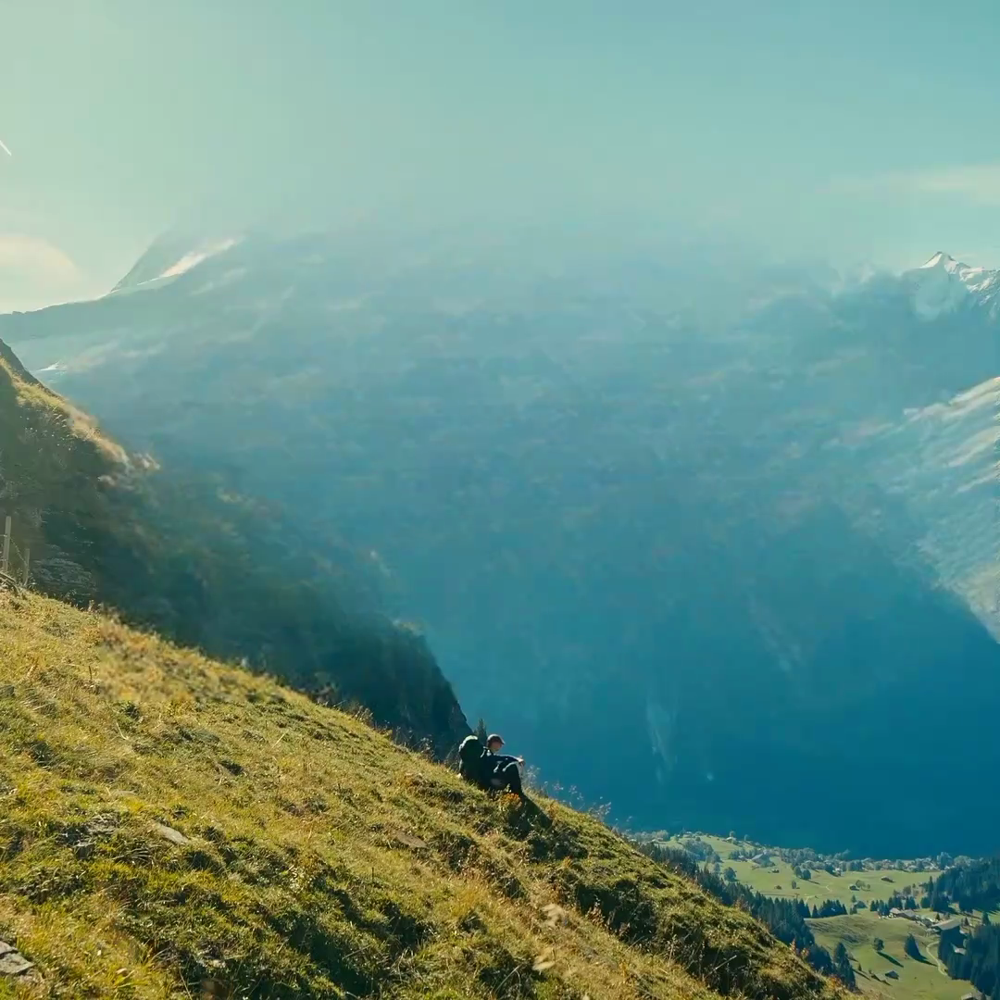
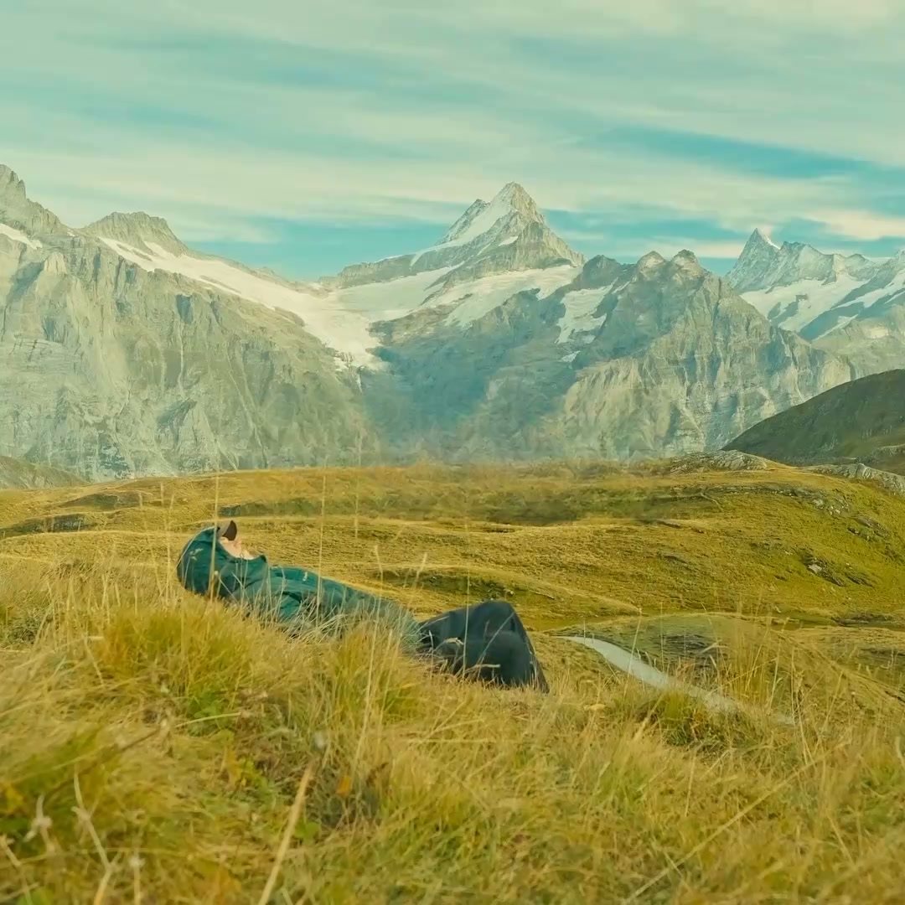
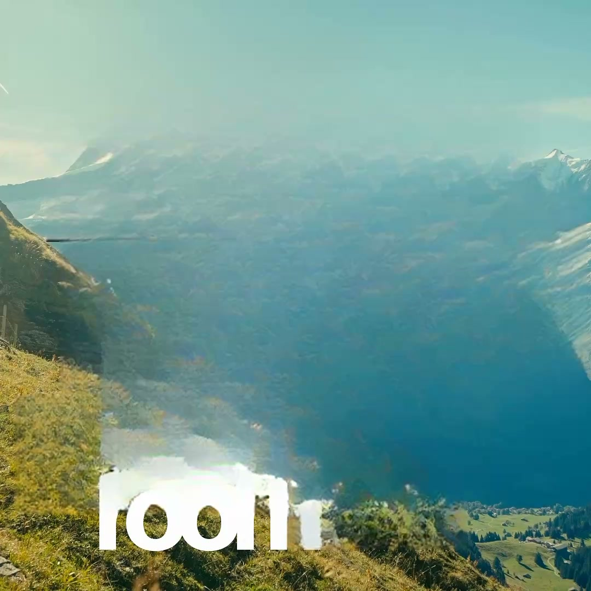

# Clean Quality — Loop 2 implementation

Date: 2026-11-08  
Team: Product + Engineer + Tester  
Fixture: `check-smoke`, `prj_9542d62ce105`, 45.833 s, 1080 × 1080, 24 fps  
Edit: `ed_093ff8d3935c`, 80 clean layers  
Verdict: **PARTIAL — P0 fixed; Loop 2 gate NOT PASSED**

## Shipped

### 1. Proof = render frame

- Added `render.render_frame`.
- Proof now calls the same `prepare_span`, fill layers, cache, key/carry state, and scale/pad/setsar/fps path as the export.
- `main.clean_preview` no longer uses `preview.render_clean_preview` for the proof.
- Proof cache is keyed by edit-clean hash + proof version + time.
- Fill cache version bumped so old masks cannot be reused.

### 2. Glyph and bright-text mask

- Large-title padding increased and capped.
- `TextMasks` grows more around titles.
- Added dense-glyph second pass.
- Added low-saturation bright-text pass for white display type on bright sky/grass.
- Per-frame text masks still narrow the hole to glyphs.

### 3. Per-sample track and fill plan

- `detect` keeps one box per OCR sample in `track`.
- `clean.layers_from_report` copies `track`, `large`, and `fill_plan.keys` to the layer.
- `mask.layer_rects_at` resolves the box per frame, with union of bracketing samples.
- `mask.frame_rects` uses the per-frame box.
- `span_key` includes `track`, `large`, and `fill_keys`.

### 4. Range edges

- Sample ranges include the half-window at the start, so the first visible frame is covered.
- This restored the scene 07 control at 25.875 s.

## Same-fixture results

### Scene 01, 1.8 s — PASS

| Check | Result |
|---|---|
| Proof/render MAD | 2.26 levels |
| p99 difference | 10 levels |
| Pixels within 10 levels | 98.1% |
| Dark component >20 px | 0 in proof, 0 in render |
| Old 242 px pill | gone |
| Visible glyph | none |




### Scene 07, 25.875 s — PASS

| Check | Result |
|---|---|
| Proof/render MAD | 2.26 levels |
| p99 difference | 8 levels |
| Pixels within 10 levels | 99.5% |
| Visible “obviously” | removed |
| Control regression | none |




### Scene 01, 3.5 s — FAIL

The animated bottom title still fails on the last frame.

- At 0.5× title padding, the white “room” remains as a residual blob.
- At 0.8× title padding, the text is removed but the bottom-left becomes a smeared green/white patch.
- Neither is acceptable. The frame is not natural.



This is the remaining Loop 2 P1. A larger LaMa work area does not solve it; it trades residual text for unnatural fill. It needs temporal/background-plate reconstruction or explicit “Needs review”.

## Tests

```text
24 passed
```

New `tests/test_clean_loop2.py` covers:

- per-frame track geometry;
- track expiry;
- track/fill_keys preservation;
- span-key invalidation on track and fill keys;
- dense glyph mask;
- bright text on bright background;
- large-title padding;
- frame rects following track.

Existing 15 core tests still pass.

## Open

| Severity | Item | Status |
|---|---|---|
| P1 | Scene 01 at 3.5 s: residual or smeared animated title | Open |
| P1 | Blur parity: render still ignores `kind == "blur"` | Open, not exercised (0 blur layers) |
| P1 | Cold proof time: 2:03 for scene 01, 41–58 s for scene 07 | Open; cache warm is fast |
| P2 | 8 fps still clamped to 4; true 8 fps fragments titles | Open, Loop 3 |
| P2 | Full 12-scene baseline not measured | Open |
| P2 | Proof gate is visual/metric harness, not a UI block | Open |

## Product gate

**Not passed.**

What is true:

- Proof and render now agree on scene 01 at 1.8 s and scene 07 at 25.875 s.
- The black “if” blob and the 242 px dark pill are gone.
- The scene 07 control holds.
- No silent blur fallback.
- 24 tests pass.

What blocks:

- Scene 01 at 3.5 s is still visibly bad. One bad frame fails the scene.
- Blur has no render path.
- Cold proof time is over the 2× baseline target.
- The plan’s first/midpoint/last/largest-frame gate is not met.

## Next

Loop 3 must target the animated bottom title:

1. Build a temporal background plate from neighbouring frames for static/animated text at scene edges.
2. If the plate is not confident, mark the frame/scene `Needs review` and do not label it clean.
3. Add the shared blur render path.
4. Implement the 8 fps range refinement after track clustering is stable.
5. Re-run the same fixture: scene 01 0.0/0.83/1.8/3.5, scene 07 25.875, scenes 04/08.

No quality claim beyond the verified 1.8 s and 25.875 s frames.
