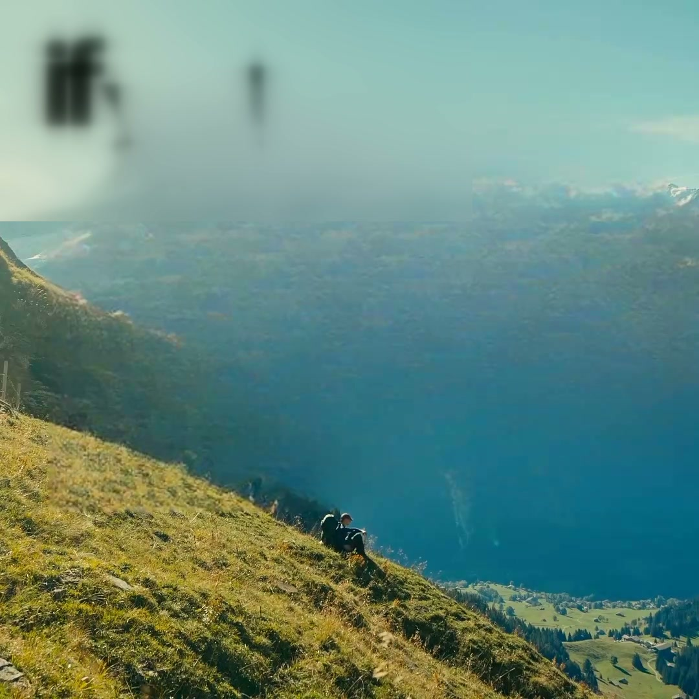
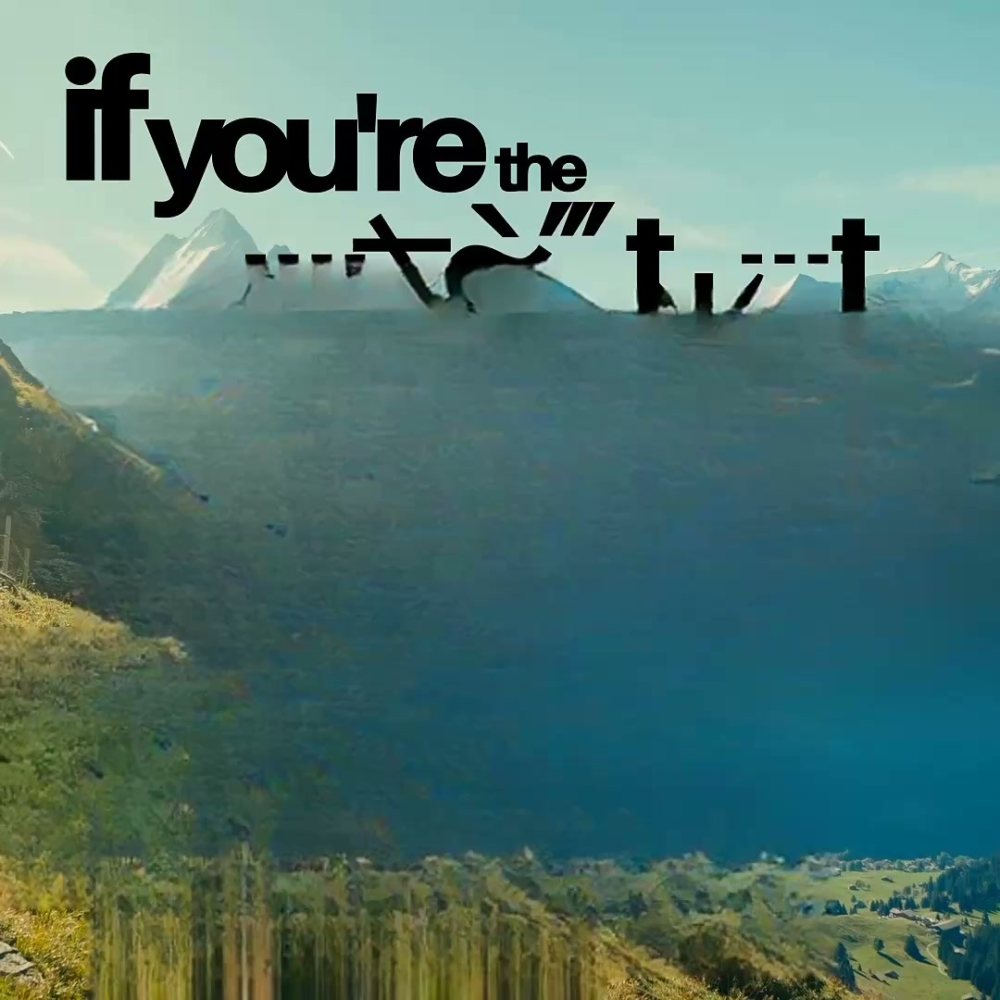
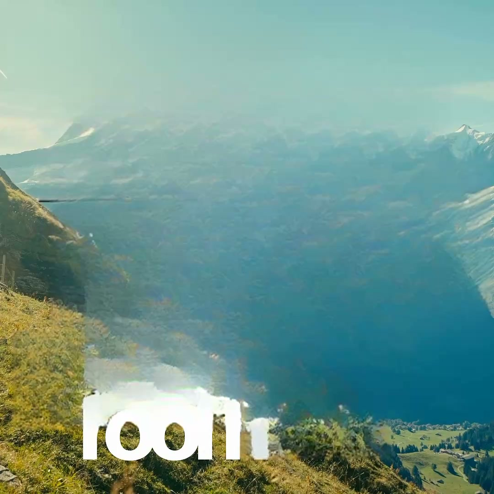

# Clean Quality — Loop 3

Date: 2026-11-08  
Team: Product + Engineer + Tester  
Fixture: `check-smoke`, `prj_9542d62ce105`, 45.833 s, 1080 × 1080, 24 fps  
Verdict: **PARTIAL — blur parity shipped; scene 01 3.5 s still fails; Loop 3 gate NOT PASSED**

## Shipped

### 1. Shared blur proof/render path

- Added `_blur_layers` and `_blur_filter` in `render.py`.
- Proof and export use the same `gblur=sigma=18` crop/overlay filter.
- Blur ranges are converted to clip-relative time.
- Proof uses only the blur layers active at that frame.
- No silent fill substitution.



### 2. Edge-text OCR pass

- Added `_edge_text_pass` in `pipeline.py`.
- Reads 2× top and bottom crops for frames with large display text.
- Maps crop boxes back to full-frame coordinates.
- Deduplicates lines already found by the full-frame read.
- Gated behind `DUCK_EDGE_TEXT=1`; default off.

Why off by default:

- It recovers the missing bottom “room” box at scene 01, 3.5 s.
- But the fill then ghosts earlier title frames into the frame and produces black smears.
- The OCR gain is real; the fill path is not ready for it.





### 3. Scan cap

- `extract_text_frames` hard cap raised from 4 to 12 fps.
- Default scan remains 4 fps.
- A global 8 fps pass was tested and reverted: it fragments the animated title and does not recover the bottom “room” by itself.
- Adaptive refinement must be range-limited and must stabilize tracklets first.

## Tests

```text
28 passed
```

New `tests/test_clean_loop3.py`:

- blur filter generates `gblur`/overlay;
- fill-only edit gets no blur;
- edge OCR line maps to full-frame coordinates;
- edge OCR deduplicates an existing line.

Existing 24 Loop 2 tests still pass.

## Results

| Check | Result |
|---|---|
| Blur proof/render parity | PASS on a synthetic blur layer |
| Edge OCR finds bottom “room” | PASS |
| Edge OCR fill at 3.5 s | FAIL, ghosts earlier title |
| Default fill at 3.5 s | FAIL, residual white text |
| Scene 01 1.8 s | PASS from Loop 2 |
| Scene 07 25.875 s | PASS from Loop 2 |
| Global 8 fps | Reverted; fragments title |
| Time | Edge pass + 8 fps exceeds budget |

## Root cause at 3.5 s

The missing “room” box is now detectable with the bottom crop. The failure is in fill, not detection:

- the large title changes position and scale rapidly;
- keyed temporal fill carries prior title frames into later frames;
- a larger LaMa work area removes the word but smears the grass/valley;
- a tight work area leaves white glyph remnants.

This needs per-frame fill with no temporal carry, or a temporal background plate. It is not a mask padding problem.

## Xcode

Xcode 27.2 is installed at `/Applications/Xcode.app`, but:

- the license has not been accepted;
- active developer directory is still `/Library/Developer/CommandLineTools`;
- `xcodebuild` fails until both are fixed.

Run:

```bash
sudo xcodebuild -license accept
sudo xcode-select -s /Applications/Xcode.app/Contents/Developer
xcodebuild -version
```

XcodeGen is not installed. `project.yml` still needs generation or manual project creation before archive.

## Product gate

**Not passed.**

- Blur parity is shipped.
- Edge OCR is proven but disabled because the fill regresses.
- Scene 01 3.5 s still fails.
- Global 8 fps is not a solution.
- No quality claim beyond Loop 2 verified frames.

## Next — Loop 4

1. Per-frame fill for animated titles: disable temporal carry/blending when a large title track changes geometry.
2. Temporal background plate for edge text when the camera is stable enough.
3. If neither is confident, mark the frame/scene `Needs review` and never label it clean.
4. Add the UI review gate for failed proofs.
5. Re-run scene 01 at 0.0 / 0.83 / 1.8 / 3.5 / 3.6 and scene 07 at 25.875.
