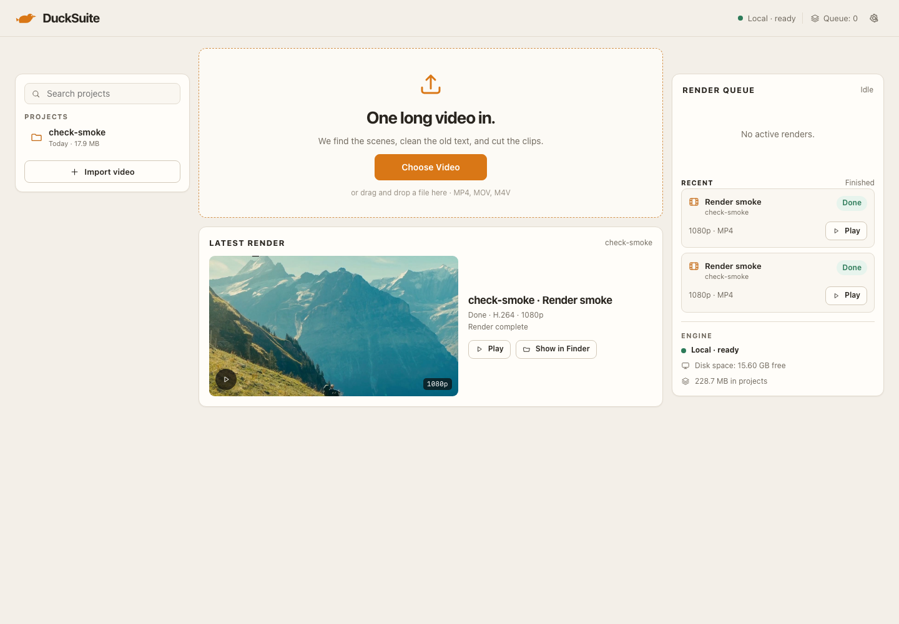
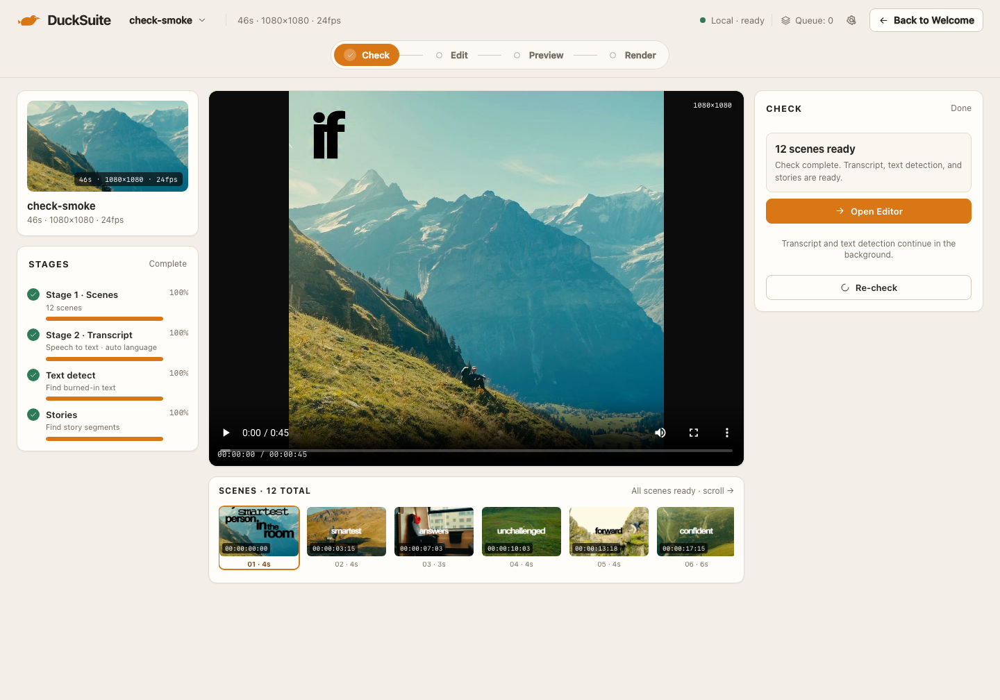

# Team — Welcome & Check · Review 01

**Date:** 2026-11-07  
**Reviewer:** Product Owner  
**Build:** local dev, 1440 × 1000  
**Verdict:** **NEEDS REVISION**

> Images show the current build for context. Findings below were recorded before the revision pass; final evidence is in the block review-02.

## Screens

## Good to go

- Welcome contains the upload surface, dashed drop target, Choose Video, drag-and-drop line, and MP4/MOV/M4V support.
- Projects, Render queue, Latest render, and Engine sit in one viewport. No account, sign-in, cloud, or pricing UI.
- Latest render has a play overlay, 1080p badge, Play, and Show in Finder.
- Check uses Check → Edit → Preview → Render with a single amber active step.
- Check shows real scene thumbnails, per-scene timecodes, durations, and a selected state.
- The dark video canvas isolates the picture from the paper chrome; native controls and mono timecodes are visible.

## Need to revise

- **Welcome** — Render queue is a history list, not a queue: cancelled and done jobs dominate. Show active/pending in the queue and move finished output to the finished-renders area.
- **Check** — the left Stages panel and the right Check panel duplicate the same four stages, green checks, Done labels, and full bars. Keep one detailed stage list and one CTA.
- **Check** — the same source is cropped differently across the source card, player, scene strip, and proof rows. Use one source-aspect treatment for the player and keep thumbnail crops intentional.
- **Welcome** — content stops around the lower third, leaving a large empty field.
- **Welcome** — the project row renders “check-smokeToday · 17.9 MB” with no separator.

## Bugs

| Severity | Screen | Bug |
|---|---|---|
| P2 | Welcome | Project name and metadata collide on one baseline. |
| P2 | Welcome | Header says “Queue: 0” while the queue panel shows four rows. |
| P2 | Check | Scene strip shows six cards with no scroll affordance. |
| P2 | Check | A floating play button sits outside the native control row. |
| P1 | Check | The visible frame is not square while the metadata claims 1080×1080. |

## Failed

- Welcome’s dominant element reads as a landing hero rather than the app entry.
- Check shows all stages Done, so the scene-first handoff is not visible; the screen has already waited for the rest.
- The note “Transcript and text detection continue in the background” sits under two Done rows.

## Visual consistency

Both screens share the Daylight Story Desk system — warm paper, white cards, amber primary, dark video, SF Pro/SF Mono — but the hero scale and duplicated stage panels break the calm workbench.
