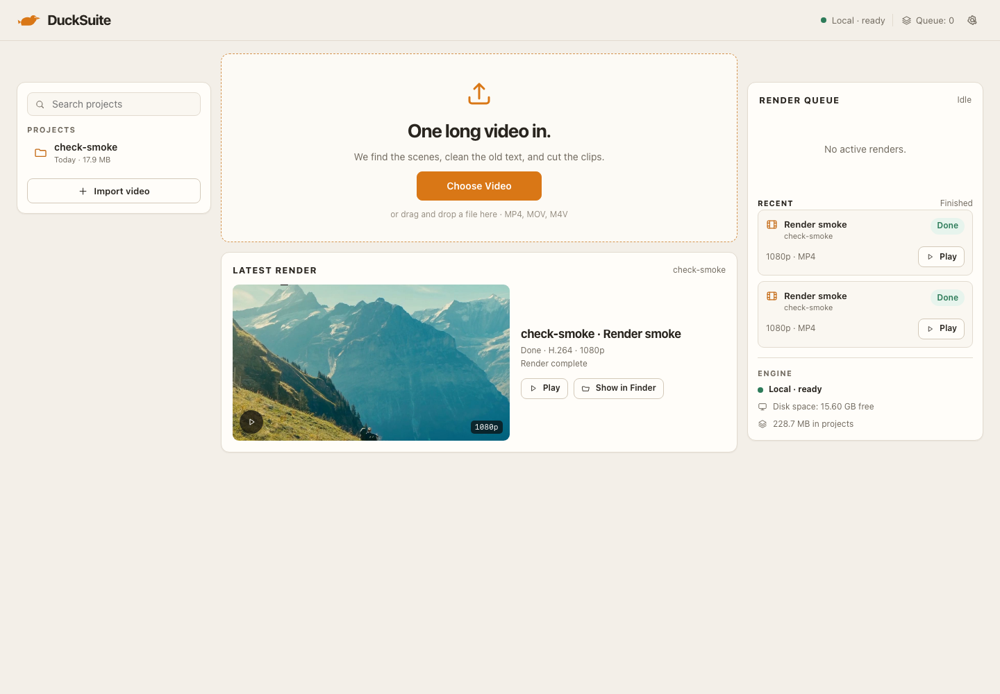
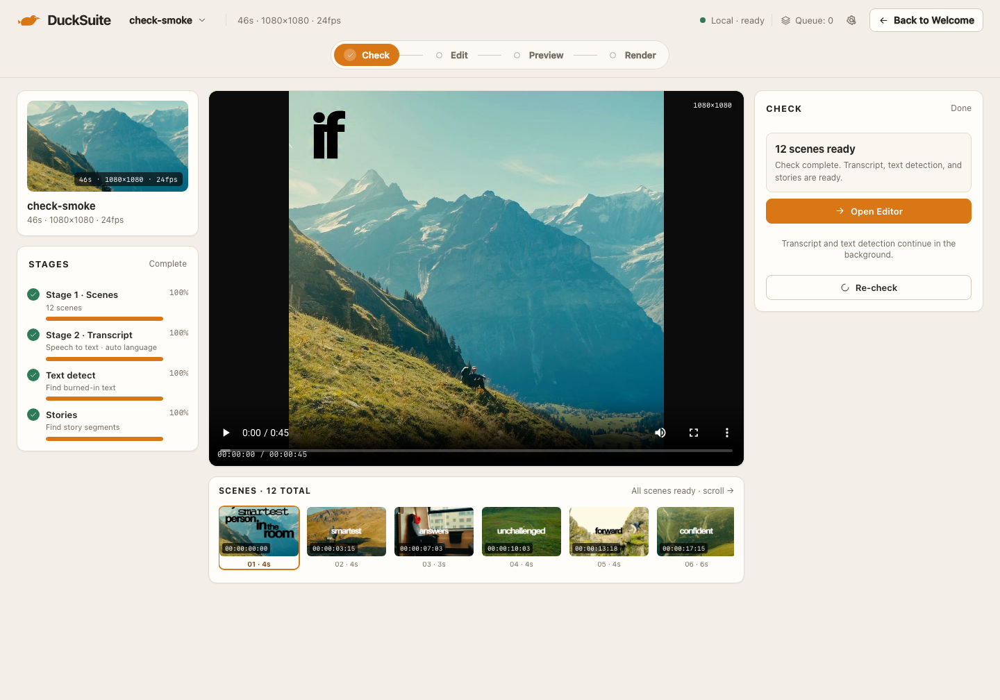

# Team — Welcome & Check · Review 02

**Date:** 2026-11-07  
**Reviewer:** Product Owner  
**Build:** local dev, 1440 × 1000  
**Verdict:** **APPROVED WITH NOTES**

## Screens

## Good to go

- Welcome opens on work: projects left, upload center, active/recent queue right, engine and disk visible.
- Render queue now separates active jobs from recent finished output. Recent renders no longer masquerade as live work.
- Latest render is a real output with Play and Show in Finder.
- Check exposes the two-phase flow in one screen: Stage 1 scenes 100%, Stage 2 transcript and text detection continuing, Stories still pending.
- The right Check panel is now a single CTA: “12 scenes ready”, Open Editor, and “Scenes are ready. The Editor opens while the rest continues.”
- Check scene strip has a visible scroll cue and real timecodes.
- Player shows the full square frame with a 1080×1080 badge; no extra floating play button.
- Source facts remain visible during a re-check (source metadata is retained).

## Resolved from Review 01

- Project row now uses two lines: name, then date and size.
- Welcome queue is active-only with a separate Recent section.
- Duplicate stage panel removed from the right side of Check.
- Check handoff is automatic when scenes first appear; the Check screen remains available for status.
- Scene strip overflow now says “scroll →”.
- Extra player button removed; native controls lead.
- Player resolution badge added.

## Remaining notes

- The primary fixture is 46 s and 1080×1080. It proves the flow but is not the long-form 1920×1080 hero the product promises; use a longer 16:9 fixture for App Store screenshots.
- The scene strip shows six cards at 1440; the remaining scenes are reachable by horizontal scroll only.
- Story candidates are still a small set in this fixture; Check’s “Stories” stage completes quickly.

## Bugs

| Severity | Screen | Bug | Status |
|---|---|---|---|
| P3 | Welcome | Latest render card repeats the first recent render. | Open, cosmetic |
| P2 | Check | 46 s square fixture weakens the “one long video” first impression. | Open, fixture issue |
| P3 | Check | Scene strip has no arrow buttons, only a scrollbar and a text cue. | Open |

## Failed

None against the reviewed flow. The scene-first handoff and single-stage-panel revision pass.

## Visual consistency

Welcome and Check now hold one Daylight Story Desk frame — warm paper, dark video, amber CTA, SF Pro/SF Mono, no marketing hero and no duplicate status architecture.
