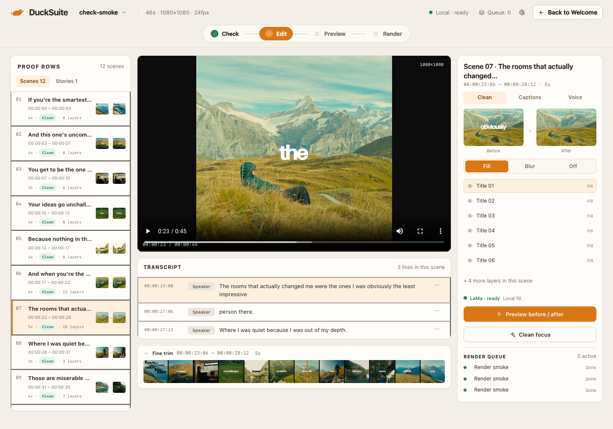
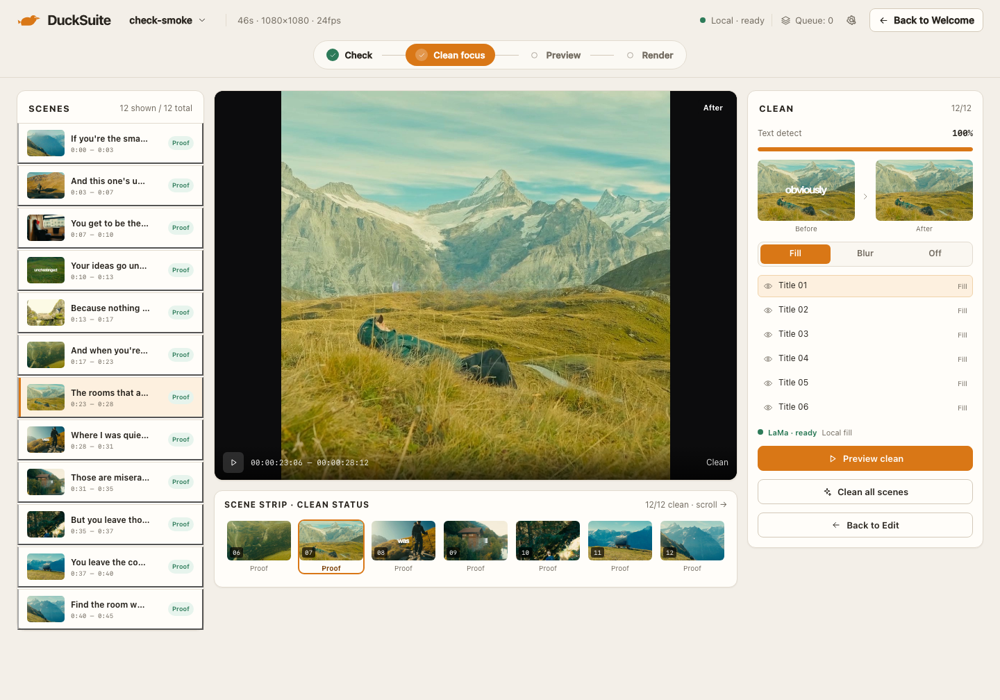

# Team — Edit & Clean Focus · Review 01

**Date:** 2026-11-07  
**Reviewer:** Product Owner  
**Build:** local dev, 1440 × 1000  
**Verdict:** **NEEDS REVISION**

> Images show the current build for context. Findings below were recorded before the revision pass; final evidence is in the block review-02.

## Screens

## Good to go

- Edit carries the required workspace: Proof Rows, preview, transcript, Clean/Captions/Voice tabs, fine trim.
- Clean Focus removes transcript, captions, voice, and fine trim while keeping the same shell, rails, paper cards, and dark canvas.
- Clean Focus centers a labeled Before/After split proof, scene list, layer list, Fill/Blur/Off, and detection status.
- Method is explicit per layer: Fill, Blur, Off. No silent blur fallback.
- Palette and type match Daylight Story Desk.

## Need to revise

- **Clean Focus** — “12/12” and “Text detect 100%” sit above “Clean all scenes”; the screen claims completion while asking for another pass.
- **Clean Focus** — green Clean chips and strip labels conflict with thumbnails that still show burned-in text.
- **Edit** — fine trim has a range and filmstrip but no clear in/out handles or playhead.
- **Edit / Clean Focus** — layer labels are fragmented OCR (“iivoutre the”, “youre la the room”, “inthe”, “in”).
- **Edit / Clean Focus** — clean tools change order: Edit uses proof → method → layers; Clean uses layers → method → proof.
- **Clean Focus** — “Clean focus” appears as a second amber selected state beside the solid amber Edit step.

## Bugs

| Severity | Screen | Bug |
|---|---|---|
| P1 | Clean Focus | Edit and Clean focus both read as selected. |
| P1 | Edit / Clean Focus | No visible route from Edit into Clean focus; only Back to Edit. |
| P2 | Clean Focus | Scene strip clips the seventh tile with no overflow cue. |
| P2 | Clean Focus | Scene 01 lists six layers while Edit reports eight plus “+2 more”. |
| P3 | Edit / Clean Focus | Titles hard-clip in Edit; time formats differ between Edit and Clean. |

## Failed

- Clean Focus reads as a fifth pipeline step, not a focus mode.
- Clean Focus’s proof state contradicts itself: 12/12 clean and 100% detect while the CTA asks to clean again and thumbnails still show text.

## Visual consistency

Both screens hold the Daylight Story Desk system, but the dual amber nav state and reordered clean modules make Clean Focus read as a different mode rather than the same Editor frame.
