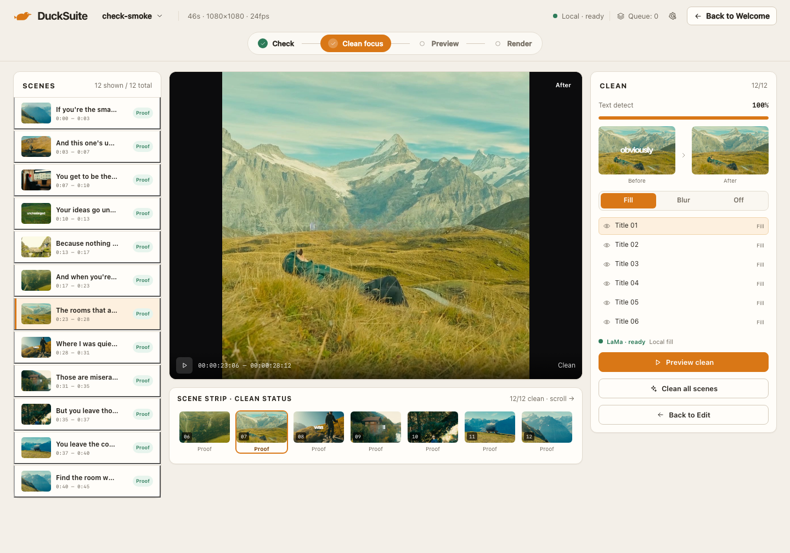

# Team — Edit & Clean Focus · Review 02

**Date:** 2026-11-07  
**Reviewer:** Product Owner  
**Build:** local dev, 1440 × 1000  
**Verdict:** **NEEDS REVISION — UI approved, clean quality P1 open**

## Screens

## Good to go

- Edit is the full workspace: Proof Rows, preview, transcript, Clean/Captions/Voice, fine trim, render queue.
- Clean Focus is now the Edit step in focus mode: the stepper reads Check → Clean focus → Preview → Render, with one amber active state.
- Clean Focus keeps the same rails, paper, dark canvas, and type. It removes transcript, captions, voice, and fine trim.
- Clean tools now share one order: proof pair → Fill/Blur/Off → layer list → model status → actions.
- Clean Focus has a forward path: Preview clean, Clean all scenes, Back to Edit.
- The selected scene 07 proof shows “obviously” removed and the full clean frame. This is the verified example.
- Layer labels now use stable product language: Screen text 01, Title 02, Subtitle 03. OCR samples stay in the tooltip.
- Scene strip has a scroll cue and clean/ proof labels instead of claiming every before thumbnail is clean.

## Resolved from Review 01

- Dual amber nav fixed: Clean focus is the Edit step label, not a second selected control.
- Edit → Clean focus entry added in the Clean inspector.
- Clean tool order unified with Edit.
- “Clean all scenes” is secondary when all scenes are layered; Preview clean is primary.
- Clean scene strip thumbnails switch to the clean proof when cached.
- Layer labels no longer expose garbled OCR as the visible name.
- Fine trim playhead now has a visible amber head and z-order.
- Scene titles use ellipsis consistently.
- Scene strip overflow says “scroll →”.

## Open P1 — clean quality

Scene 01, the full-height “if you’re the smartest person in the room” title, leaves a dark artifact after LaMa Fill. The proof is generated, but it is not clean enough to call “Clean”. Scene 07 is a clean verified result.

Required before launch:

1. Expand or correct the text mask for very large stylized glyphs on scene 01.
2. Add a proof-quality check that does not mark a scene “Proof” when dark text remnants remain.
3. Keep Blur/Off explicit; never auto-fallback.
4. Use a verified clean result as the App Store and first-run proof.

## Bugs

| Severity | Screen | Bug | Status |
|---|---|---|---|
| P1 | Clean Focus | Large stylized text on scene 01 leaves a dark artifact after Fill. | Open, model/mask |
| P2 | Clean Focus | Default selected scene 01 is the weakest proof; scene 07 is the strong example. | Open |
| P2 | Clean Focus | “12/12” counts layers, not verified proofs. | Open, labeled |
| P3 | Edit | Fine trim still lacks draggable in/out handles. | Open |
| P3 | Clean Focus | Scene strip clips the seventh tile; scroll cue only. | Open |

## Failed

- **Clean quality on scene 01 fails the key selling-point test.** The UI is honest and exposes the artifact, but the default Fill result is not launch-quality on that title.
- No silent blur fallback was observed. The failure is visible, which is the correct behavior.

## Visual consistency

Edit and Clean Focus now read as one product: same shell, same type, same amber, same proof pair and method order. The only break is the model result on scene 01.
