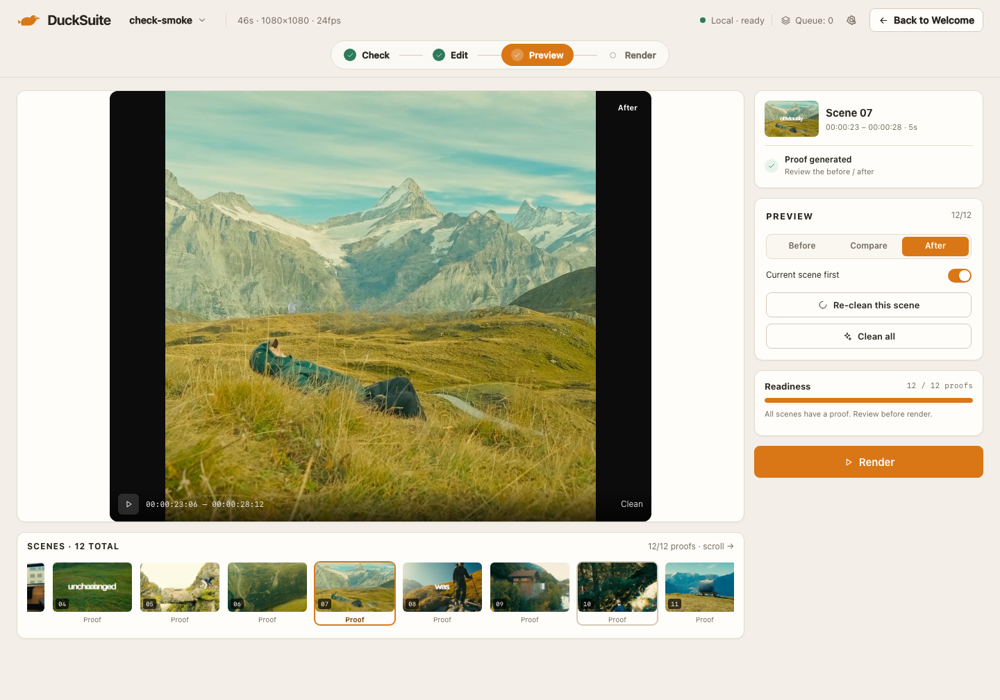
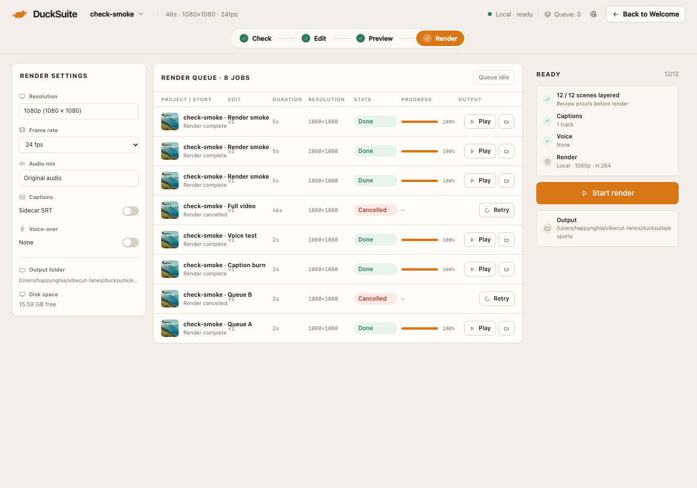

# Team — Preview & Render · Review 01

**Date:** 2026-11-07  
**Reviewer:** Product Owner  
**Build:** local dev, 1440 × 1000  
**Verdict:** **NEEDS REVISION**

> Images show the current build for context. Findings below were recorded before the revision pass; final evidence is in the block review-02.

## Screens

## Good to go

- Preview makes the before/after player the page anchor.
- Divider handle, Before/After tags, play control, and range timecode are present.
- Scene 01 is selected; Current scene first is on.
- Re-clean, Clean all, and readiness are present.
- Filmstrip has numbered frames, Ready states, and an amber selected outline.
- Render queue shows duration, resolution, state, progress, Play/folder, or Retry.
- Render settings and READY/output rail cover resolution, fps, audio, captions, voice, output folder, disk space, and clean count.

## Need to revise

- **Preview** — the split shows two different-looking halves with a grade jump at the seam. Use one time and one grade; only the text region changes. Add a full-frame After view.
- **Preview** — filmstrip clips at scene 9 with no scrollbar, arrows, or fade cue.
- **Preview** — Scene 01 and visible thumbnails still show burned-in text while the page claims 12/12 clean and “Clean proof ready”. Use cleaned thumbnails or label them Source/Before.
- **Render** — “1080p (1920 × 1080)” contradicts the 1080×1080 project header. Lock output to the source aspect.
- **Render** — Resume and Pause are both enabled on an idle queue.
- **Render** — cancelled rows show a progress bar plus “—”.

## Bugs

| Severity | Screen | Bug |
|---|---|---|
| P1 | Preview | Split halves read as different frames and grades, so the clean proof is not trusted. |
| P1 | Render | Output claims 1920×1080 for a 1080×1080 project. |
| P2 | Preview | Filmstrip overflow hides scenes 9–12 without an affordance. |
| P2 | Render | Idle queue enables Resume and Pause together. |
| P2 | Render | Cancelled progress is an unlabeled bar plus “—”. |

## Failed

- “Before / after is real” fails: the split does not prove the cleaned title.
- Render output spec fails for the square project.
- Render cancel/resume state does not reflect queue state.

## Visual consistency

Both screens hold the Daylight Story Desk frame, but mint-green done pills and ready checks sit slightly outside the stated palette and the Preview proof does not yet earn its “real” label.
