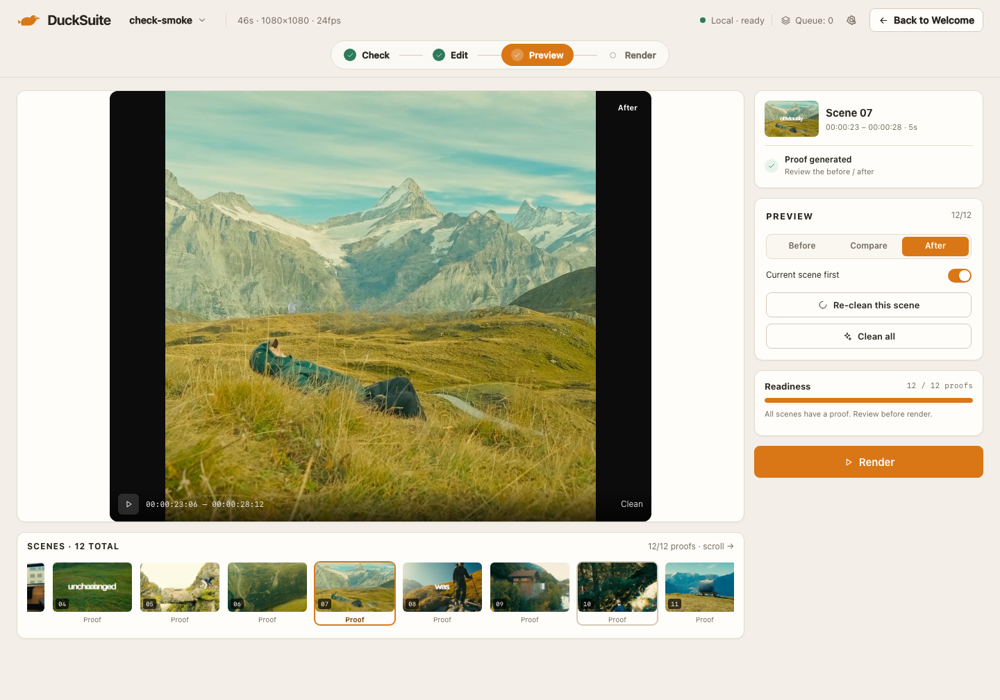
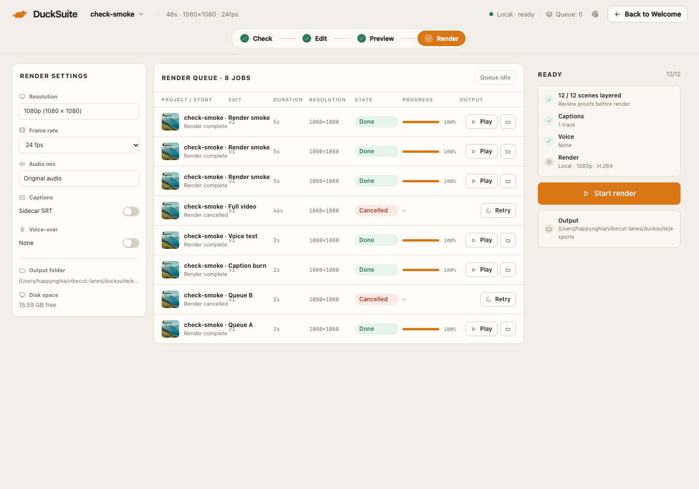

# Team — Preview & Render · Review 02

**Date:** 2026-11-07  
**Reviewer:** Product Owner  
**Build:** local dev, 1440 × 1000  
**Verdict:** **APPROVED WITH NOTES**

## Screens

## Good to go

- Preview now has three explicit views: Before, Compare, After. After is the default and shows the full clean frame.
- The compare wipe remains available for the before/after proof.
- The selected scene 07 proof shows “obviously” removed with no grade jump. This is the verified example.
- Scene strip has a scroll cue; 12 scenes are reachable.
- Preview no longer claims “Clean proof ready” for every scene. It says “Proof generated” and asks for review.
- Readiness says 12/12 proofs, not 12/12 clean.
- Render resolution is 1080p (1080 × 1080), matching the project.
- Queue control is state-appropriate: Queue idle, Pause while active, Resume when paused.
- Cancelled rows show a neutral dash, no misleading progress bar.
- Render settings and READY rail remain complete.

## Resolved from Review 01

- Preview default changed to full After proof; Compare and Before are explicit.
- Proof labels changed from Clean/Ready to Proof.
- Scene strip overflow cue added; clean thumbnails used when cached.
- Render resolution derives from source metadata.
- Resume/Pause replaced with one state-appropriate control.
- Cancelled progress bar removed.
- 1080×1080 output label locked to the actual project.
- `CLEAN` chips in Clean Focus changed to `Proof` where a proof exists; `Layered` otherwise.

## Remaining notes

- Some scenes still contain text in their proof because LaMa failed to remove very large stylized glyphs. The UI exposes the proof and does not hide the result. This is the same open P1 as Team 2.
- The Render screenshot shows a queue with done and cancelled jobs and a disabled “Queue idle” control. A live encoding row is not present at capture time.
- Scene 07 is the verified clean example; scene 01 is the known artifact.

## Bugs

| Severity | Screen | Bug | Status |
|---|---|---|---|
| P1 | Preview / Render | Some proofs still contain burned-in text; 12/12 proof count includes them. | Open, shared with Team 2 |
| P2 | Preview | Filmstrip still requires horizontal scroll; no arrow buttons. | Open |
| P2 | Render | Queue mixes historical done/cancelled jobs with current work; no archive action. | Open |
| P3 | Render | Output folder path truncates at 1440. | Open |
| P3 | Preview | Before view still shows the original square frame with side pillars. | Accepted |

## Failed

None against the reviewed UI flow. The remaining P1 is model/proof quality, not a navigation or layout failure.

## Visual consistency

Preview and Render hold the Daylight Story Desk frame: warm paper, dark video, amber primary, SF Pro/SF Mono, flat cards, one primary action. The proof-quality artifact is visible, not disguised.
